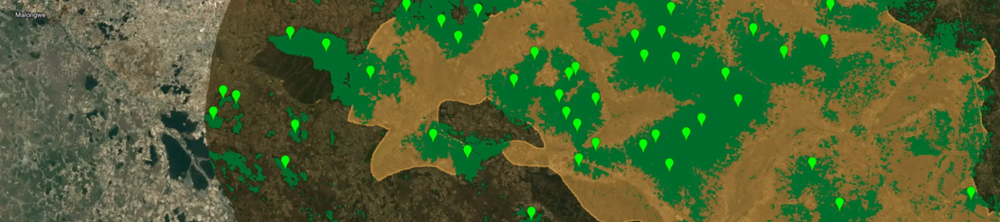
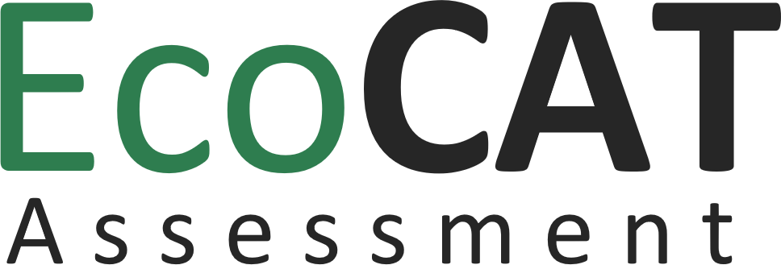

This project aims to develop an open, modular application to assess ecosystem distribution, trends, function, degradation and risk of collapse following the IUCN Red List of Ecosystems guidelines

## Tools

::: {layout="[45,-10,45]"}
::: text-center
[**Mapping tool**](https://map.ecocatproject.org){target="_blank"}: automated ecosystem mapping and how they change over time.

[{width="200"}](https://map.ecocatproject.org){target="_blank"}
:::

::: text-center
[**Assessment tool**](https://assess.ecocatproject.org){target="_blank"}: assess ecosystem status following Red List of Ecosystems Guidelines.

[{width="200" style="margin-top: 2em;"}](https://assess.ecocatproject.org){target="_blank"}
:::
:::
